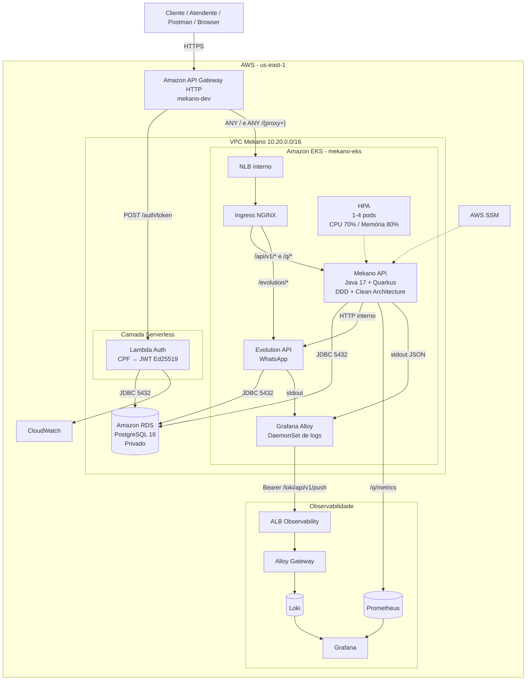
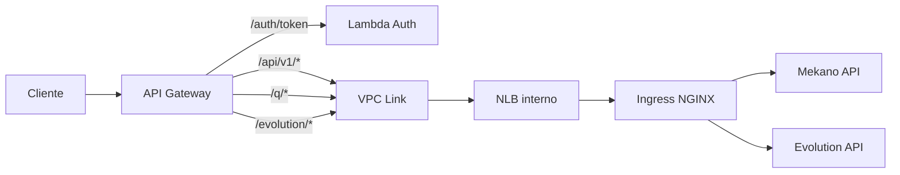

# 01 — Arquitetura e Diagrama de Componentes

## Objetivo

Apresentar a visão consolidada da arquitetura Mekano, cobrindo nuvem, API Gateway, EKS, Lambda, banco, Evolution API e observabilidade.

## Repositórios analisados

- `Mekano-API`
- `Mekano-Infrastructure-K8s`
- `Mekano-Infrastructure-Database`
- `Mekano-Serverless`
- `Mekano-infrastructure-Observability`

## Visão geral

```text
Cliente
  ↓
API Gateway
  ├── POST /auth/token
  │       ↓
  │    Lambda Auth
  │       ↓
  │    PostgreSQL
  │       ↓
  │      JWT
  │
  └── /api/v1/*, /q/*, /evolution/*
          ↓
       VPC Link
          ↓
       NLB interno
          ↓
      Ingress NGINX
       ├── Mekano API
       └── Evolution API

Persistência:
Mekano API / Lambda / Evolution → RDS PostgreSQL 16

Observabilidade:
Pods → Alloy → Loki → Grafana
Mekano API /q/metrics → Prometheus → Grafana
```

## Diagrama de Componentes



## Fluxo do API Gateway



## Responsabilidades

### API Gateway
- ponto único de entrada pública;
- direciona `/auth/token` para a Lambda;
- envia as demais rotas por VPC Link;
- evita exposição direta dos workloads internos.

### Lambda Auth
- valida CPF;
- consulta o cliente;
- verifica status;
- gera JWT Ed25519.

### Mekano API
- regras de negócio;
- validação de JWT;
- autorização por roles;
- OS, orçamento, estoque, clientes e veículos.

### Evolution API
- comunicação com WhatsApp;
- envio e recebimento de mensagens;
- webhooks integrados à Mekano API.

### PostgreSQL
- persistência transacional;
- dados da aplicação;
- dados utilizados na autenticação;
- armazenamento utilizado pela Evolution conforme configuração.

### Observabilidade
- Prometheus: métricas;
- Alloy: coleta de logs;
- Loki: armazenamento e consulta de logs;
- Grafana: dashboards e alertas.

## Observação de arquitetura

A documentação consolidada considera a arquitetura atual com:

```text
VPC Mekano 10.20.0.0/16
├── EKS
├── Lambda
└── RDS
```

Documentos antigos que ainda mencionem VPC Peering devem ser revisados.
