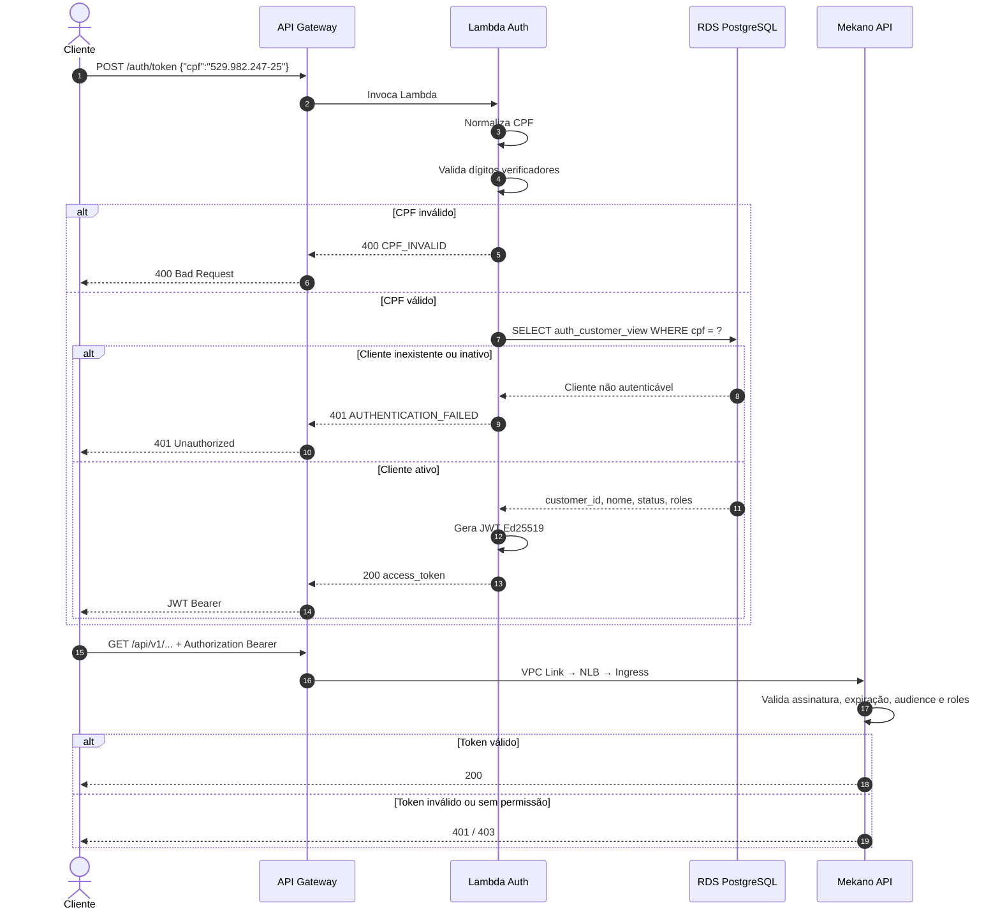
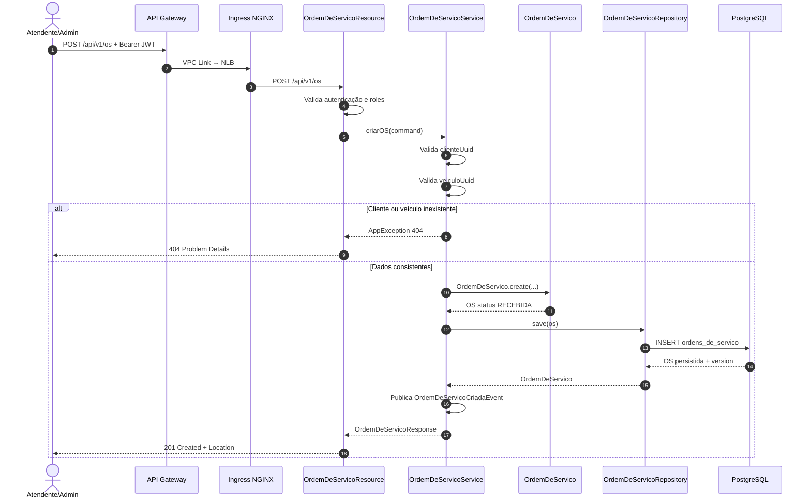

# 02 — Diagramas de Sequência

# 1. Autenticação do Cliente por CPF

## Objetivo

Representar o fluxo de autenticação usando API Gateway, Lambda, PostgreSQL e JWT.



## Resumo do fluxo

```text
Cliente informa CPF
        ↓
API Gateway
        ↓
Lambda Auth
        ↓
Validação matemática
        ↓
Consulta PostgreSQL
        ↓
Cliente ativo
        ↓
JWT Ed25519
        ↓
Cliente usa Bearer Token
        ↓
API Gateway
        ↓
Mekano API
        ↓
Validação JWT + Roles
```

---

# 2. Abertura de Ordem de Serviço

## Objetivo

Representar o fluxo da criação da Ordem de Serviço desde a entrada pública até a persistência.



## Resumo

```text
Atendente/Admin
       ↓
API Gateway
       ↓
VPC Link
       ↓
NLB
       ↓
Ingress NGINX
       ↓
OrdemDeServicoResource
       ↓
OrdemDeServicoService
       ↓
Valida Cliente e Veículo
       ↓
Cria OS com status RECEBIDA
       ↓
Repository
       ↓
PostgreSQL
       ↓
201 Created
```

## Estado inicial da OS

A nova Ordem de Serviço é criada com:

```text
RECEBIDA
```

e segue o fluxo de negócio posteriormente para diagnóstico, orçamento, execução, finalização e entrega.
