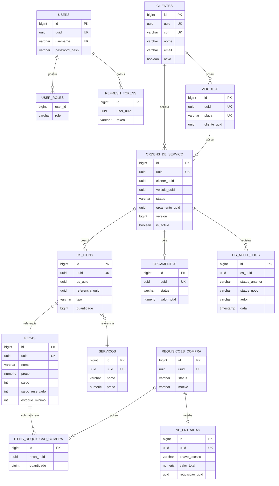
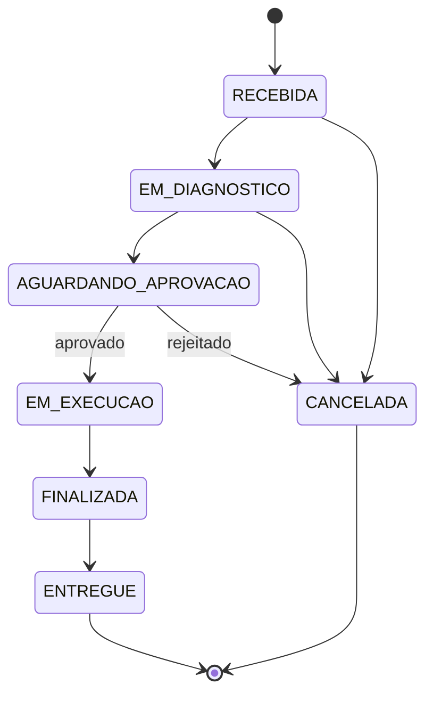

# 04 — Banco de Dados, Modelo Relacional e Diagrama ER

## 1. Justificativa formal do banco

O domínio Mekano possui operações que exigem consistência forte:

- Ordem de Serviço;
- cliente;
- veículo;
- orçamento;
- estoque;
- reserva de peças;
- requisição de compra;
- nota fiscal;
- pagamento;
- auditoria.

Essas características tornam o modelo relacional adequado.

## 2. Por que PostgreSQL

PostgreSQL foi escolhido pelos seguintes motivos:

- transações ACID;
- integridade;
- constraints;
- índices;
- joins;
- UUID;
- JSONB;
- controle concorrente;
- integração com Hibernate/Panache;
- Flyway;
- Testcontainers;
- amplo suporte no Amazon RDS.

## 3. Por que Amazon RDS

O RDS reduz o esforço de operação.

Benefícios:

- banco gerenciado;
- criptografia;
- snapshots;
- backups conforme configuração;
- Security Groups;
- subnets privadas;
- possibilidade futura de Multi-AZ.

Configuração importante:

```text
publicly_accessible = false
```

## 4. Diagrama Entidade-Relacionamento



## 5. Relacionamentos

| Relacionamento | Cardinalidade | Explicação |
|---|---:|---|
| Cliente → Veículo | 1:N | cliente possui vários veículos |
| Cliente → OS | 1:N | cliente pode abrir várias OS |
| Veículo → OS | 1:N | veículo pode ter vários atendimentos |
| OS → Itens | 1:N | peças e serviços compõem a OS |
| OS → Orçamento | 1:0..1 | orçamento associado à OS |
| OS → Auditoria | 1:N | histórico de transições |
| Requisição → Itens | 1:N | várias peças na compra |
| Requisição → NFe | 1:0..1 | entrada vinculada à compra |

## 6. Ajustes no modelo relacional

### BIGINT + UUID

O modelo utiliza:

```text
BIGINT IDENTITY
+
UUID UNIQUE
```

O BIGINT é utilizado como chave física e o UUID como identidade pública.

### Soft Delete

Preserva histórico ao invés de remover fisicamente registros de negócio.

### Optimistic Locking

A Ordem de Serviço possui:

```text
version
```

para evitar conflitos de atualização concorrente.

### Reserva de estoque

A peça possui:

```text
saldo
saldo_reservado
estoque_minimo
```

Isso ajuda a impedir overselling.

### Auditoria

`os_audit_logs` registra:

- status anterior;
- novo status;
- autor;
- data da alteração.

### Migrações

Flyway é a fonte de verdade do schema.

## 7. Fluxo de estados da OS


