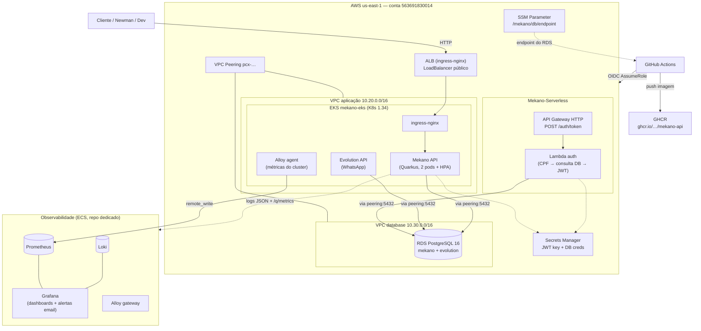

# Arquitetura — Mekano (Tech Challenge)

Documentação arquitetural da solução: componente de nuvem, decisões formais (ADRs/RFCs), modelo de dados e fluxos de sequência.

## Repositórios

| # | Repo | Papel | CI/CD |
|---|------|-------|-------|
| 1 | **Mekano-API** (este repo) | Aplicação Quarkus (Clean Architecture) | CI (PR) + CD: build/testes → imagem no GHCR |
| 2 | **Mekano-Serverless** | Lambda de autenticação (CPF → JWT) + API Gateway HTTP | CD: deploy automático na AWS via OIDC |
| 3 | **Mekano-Infrastructure-K8s** | Terraform (VPC + EKS) + manifests Kubernetes + deploy | CD: plan em PR, apply em main |
| 4 | **Mekano-Infrastructure-Database** | Terraform (VPC dedicada + RDS PostgreSQL) + peering | CD: `workflow_dispatch` (plan/apply/destroy com guarda) |
| + | **Mekano-infrastructure-Observability** | Stack Alloy + Loki + Prometheus + Grafana (ECS) | CD + Terraform |

## Diagrama de Componentes (visão de nuvem)

## Documentos

| Tipo | Documento | Assunto |
|------|-----------|---------|
| ADR | [ADR-001 — AWS como provedor de nuvem](ADR-001-aws-como-nuvem.md) | Escolha da nuvem |
| ADR | [ADR-002 — PostgreSQL gerenciado (RDS)](ADR-002-postgresql-rds.md) | Escolha do banco |
| ADR | [ADR-003 — EKS + HPA](ADR-003-eks-hpa.md) | Orquestração e autoscaling |
| ADR | [ADR-004 — Comunicação REST síncrona + eventos internos](ADR-004-comunicacao-rest-eventos.md) | Padrão de comunicação |
| ADR | [ADR-005 — Observabilidade self-hosted](ADR-005-observabilidade-selfhosted.md) | Alloy/Loki/Prometheus/Grafana |
| RFC | [RFC-001 — Autenticação CPF com Lambda serverless](RFC-001-autenticacao-cpf-lambda.md) | Estratégia de autenticação |
| RFC | [RFC-002 — Banco em VPC dedicada com VPC peering](RFC-002-vpc-peering-banco-dedicado.md) | Topologia de rede |
| RFC | [RFC-003 — Nó único no Free Tier](RFC-003-free-tier-single-node.md) | Restrição de custo |
| Modelo | [Modelo de dados (ER) + justificativa do banco](modelo-de-dados-er.md) | ER, relacionamentos e ajustes |
| Sequência | [Autenticação CPF (Lambda → JWT)](sequencia-autenticacao-cpf.md) | Fluxo de autenticação |
| Sequência | [Abertura de Ordem de Serviço](../sequence-diagrams/criar-os.md) | Fluxo de negócio (pré-existente) |

## Fluxos complementares (já documentados em `docs/sequence-diagrams/`)

- [Ciclo completo da OS](../sequence-diagrams/fluxo-completo-os-lifecycle.md)
- [Requisição de compra por estoque mínimo](../sequence-diagrams/requisicao-compra-estoque-minimo.md)
- [Consulta pública de status](../sequence-diagrams/consulta-publica-status.md)
