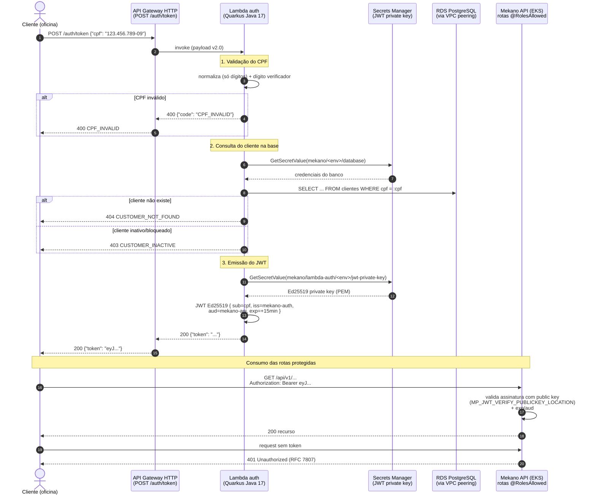

# Sequência — Autenticação por CPF (Lambda → JWT)

Requisito: proteger rotas sensíveis com autenticação **via CPF**, através de function serverless que valida o CPF, consulta o cliente na base e devolve um JWT.

> Implementação: [Mekano-Serverless](https://github.com/FIAP-SOFTWARE-ARCHITECTURE-TEAM/Mekano-Serverless) · Decisão: [RFC-001](RFC-001-autenticacao-cpf-lambda.md)

## Pontos de segurança

| Aspecto | Tratamento |
|---------|-----------|
| Chave de assinatura | Ed25519, privada **apenas no Secrets Manager** — nunca em código/repo; API conhece só a pública |
| Exposição do banco | Lambda dentro da VPC do app; RDS privado; acesso 5432 restrito ao CIDR da VPC (peering) |
| Validade do token | 15 min (`exp`), claims `iss`/`aud` verificados pela API |
| Entrada maliciosa | CPF normalizado/validado antes de qualquer query (prepared statement) |
| Throttling | API Gateway: 25 rps / burst 50 |
| Auditoria | Falhas de autenticação aparecem nos logs JSON com `correlationId` (dashboard/alertas da observabilidade) |

## Status

- ✅ Código + testes (14 testes), Terraform, API Gateway e smoke test de deploy prontos no repo Mekano-Serverless (branch `feature/mekano-serveless-lb`);
- ⚠️ Pendente: merge para `main` (responsável do repo) + secrets `mekano/<env>/database` e `mekano/lambda-auth/<env>/jwt-private-key` no Secrets Manager — ver [RFC-001](RFC-001-autenticacao-cpf-lambda.md).
